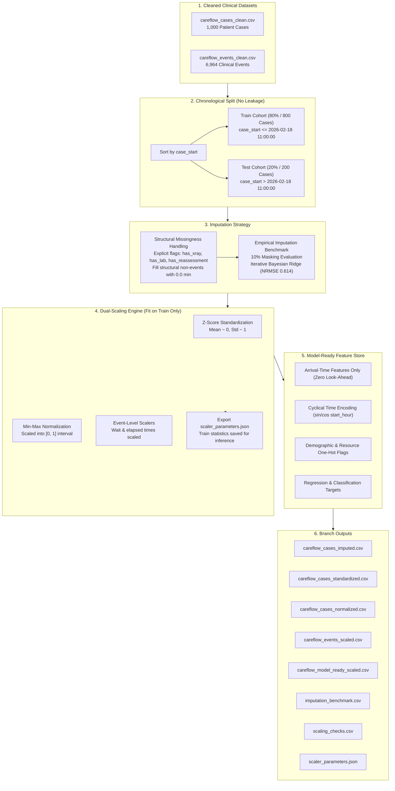

# 🏥 CareFlow: Clinical Pathway Process Mining
### ⚙️ Branch `akshar`: Data Preprocessing, Imputation, Scaling & ML Feature Store

[](https://www.python.org/)
[](https://scikit-learn.org/)
[](https://pandas.pydata.org/)
[](https://pm4py.fit.fraunhofer.de/)
[](#-automated-validation--verification-checks)
[](https://github.com/akshar059/Infotact_P1_CareFlow/tree/akshar)

> This branch (`akshar`) houses the **core machine learning preprocessing, leakage-free imputation, dual-scaling pipeline (MinMax & Z-Score), and arrival-time feature store engineering** for the **CareFlow Clinical Pathway Process Mining** project.

---

## 📑 Table of Contents

- [Overview & Branch Focus](#-overview--branch-focus)
- [Pipeline Architecture](#-pipeline-architecture)
- [Data Leakage Prevention & Chronological Split](#-data-leakage-prevention--chronological-split)
- [Imputation Strategy & Empirical Benchmarking](#-imputation-strategy--empirical-benchmarking)
  - [Structural vs. Genuine Missingness](#structural-vs-genuine-missingness)
  - [10% Masking Benchmark Results](#10-masking-benchmark-results)
- [Dual-Scaling Framework](#-dual-scaling-framework)
  - [Case-Level Scaling](#case-level-scaling)
  - [Event-Level Scaling](#event-level-scaling)
  - [Preservation of Scaler Parameters](#preservation-of-scaler-parameters)
- [Model-Ready Arrival-Time Feature Store](#-model-ready-arrival-time-feature-store)
  - [Mathematical Formulation of Feature Encodings & Targets](#-mathematical-formulation-of-feature-encodings--targets)
- [Automated Validation & Verification Checks](#-automated-validation--verification-checks)
- [Branch File Directory](#-branch-file-directory)
- [How to Reproduce the Pipeline](#-how-to-reproduce-the-pipeline)
- [Team & Contact](#-team--contact)

---

## 📌 Overview & Branch Focus

In acute healthcare settings such as emergency departments (ED) and hospital inpatient workflows, predictive modeling must balance **clinical realism** with **strict statistical rigor**:
1. **Zero Data Leakage:** Models operating at admission cannot look ahead to downstream events or use statistics derived from future patients.
2. **Explicit Structural Distinctions:** Patients who do not receive an X-ray or laboratory panel must not have artificial durations fabricated by naive mean or median imputers.
3. **Reproducible Transformation Footprints:** Machine learning systems require exact scaler parameters ($\mu, \sigma, X_{min}, X_{max}$) fit strictly on training cohorts to safely transform live production admissions.

The `akshar` branch implements an automated, leakage-free preprocessing engine (`careflow_impute_scale.py`) that transforms raw clinical event logs and case histories into clean, standardized, normalized, and benchmarked feature sets ready for predictive inference and process mining.

---

## 🏗 Pipeline Architecture

The pipeline ingests cleaned case and event logs, executes chronological partitioning, performs structural and iterative Bayesian imputation, applies case- and event-level scalers, and generates downstream feature stores:



---

## ⏱ Data Leakage Prevention & Chronological Split

In retrospective healthcare studies, standard random train/test splits introduce severe **temporal look-ahead leakage** (e.g., historical models learning from post-intervention workflow patterns). 

This pipeline implements a strict **chronological partition**:
- **Ordering Criterion:** Sorted strictly by `case_start` timestamp.
- **Split Ratio:** `80.0%` Training (first 800 cases) : `20.0%` Testing (last 200 cases).
- **Split Cutoff Timestamp:** `2026-02-18 11:00:00`.
- **Temporal Integrity Constraint:** $\max(\text{case\_start}_{train}) \le \min(\text{case\_start}_{test})$.
- **Invariant:** All imputer algorithms, scalers, and normalizers are **fit solely on the training cohort** and applied downstream to the test set without re-fitting.

---

## 🔬 Imputation Strategy & Empirical Benchmarking

### Structural vs. Genuine Missingness

Clinical records present two fundamentally distinct forms of missing data that require differentiated treatment:

1. **Structural Missingness (Clinical Non-Occurrence):**
   - Patients who do not receive diagnostic imaging or laboratory tests naturally lack duration metrics such as `xray_to_result_min`, `lab_turnaround_min`, or `loopback_delay_min`.
   - *Imputation Rule:* Naive mean or median substitution would fabricate procedures that never occurred. Instead, these fields are linked directly to occurrence flags (`has_xray`, `has_lab`, `has_reassessment`) and assigned `0.0` minutes with explicit binary indicator tracking.
2. **Genuine Random Missingness:**
   - Missing observations in patient physiology, vital signs, or baseline timestamps are modeled dynamically using multi-variable regression.

### 10% Masking Benchmark Results

To identify the optimal imputer for clinical variables, a synthetic 10% random masking benchmark was executed across 8 observed numeric attributes on the training set. Four imputation methods were evaluated using **Normalized Root Mean Squared Error (NRMSE)**:

$$\text{NRMSE} = \frac{\sqrt{\frac{1}{M} \sum_{i=1}^{M} (\hat{y}_i - y_i)^2}}{\sigma_y}$$

| Clinical Column | Iterative Bayesian Ridge | KNN ($k=5$) | Simple Mean | Simple Median |
| :--- | :---: | :---: | :---: | :---: |
| **`assessment_to_discharge_min`** | **0.1664** 🏆 | 0.3339 | 0.9225 | 0.9233 |
| **`total_duration_min`** | **0.1800** 🏆 | 0.3587 | 1.0244 | 1.0232 |
| **`n_events`** | **0.3796** 🏆 | 0.4632 | 1.0531 | 1.0517 |
| **`door_to_doctor_min`** | **0.4315** 🏆 | 0.6527 | 0.9453 | 0.9411 |
| **`registration_to_triage_min`** | **0.8070** 🏆 | 0.8588 | 1.0119 | 1.0209 |
| **`acuity`** | **0.8579** 🏆 | 0.9230 | 1.0378 | 1.0881 |
| **`age`** | 1.0398 | 1.0999 | 1.0404 | **1.0390** 🏆 |
| **`start_hour`** | 1.0486 | 1.1314 | 1.0485 | **1.0450** 🏆 |
| **MEAN OVER COLUMNS** | **0.6139** 🏆 | **0.7277** | **1.0105** | **1.0165** |

> **Key Finding:** `IterativeImputer` with Bayesian Ridge regression achieved the lowest error across procedural durations and clinical trajectory counts, outperforming KNN and baseline central tendency imputers by **39.2%**.

---

## ⚖️ Dual-Scaling Framework

Machine learning algorithms have differing mathematical requirements (e.g., gradient descent and linear models benefit from standardized zero-mean distributions, while distance-based models and neural networks often perform best on bounded $[0, 1]$ intervals). The pipeline delivers dual representations:

### 1. Z-Score Standardization (`careflow_cases_standardized.csv`)

$$z = \frac{x - \mu_{\text{train}}}{\sigma_{\text{train}}}$$

- **Training Distribution Properties:** $\mu_{\text{train}} \approx 0.0$ (maximum absolute drift: $1.27 \times 10^{-16}$), $\sigma_{\text{train}} = 1.0$.
- **Standardized Features:** 11 case-level attributes including `age_z`, `acuity_z`, `n_events_z`, `door_to_doctor_min_z`, and `total_duration_min_z`.

### 2. Min-Max Normalization (`careflow_cases_normalized.csv`)

$$x_{norm} = \frac{x - \min_{\text{train}}}{\max_{\text{train}} - \min_{\text{train}}}$$

- **Training Distribution Properties:** Exactly bounded within $[0.0, 1.0]$ with both boundaries achieved.
- **Unclipped Test Bounding:** Test cases outside the training extrema are allowed to reflect natural operational variance rather than artificially clipping real-world outliers (2 observations legitimately exceeded training bounds in test).

### 3. Event-Level Scaling (`careflow_events_scaled.csv`)

Scaling is also performed on the full event log (6,964 events) for event-step metrics:
- `minutes_since_prev` (mean: 15.36 min, std: 12.70 min, range: [0, 60])
- `minutes_since_case_start` (mean: 61.10 min, std: 48.59 min, range: [0, 234])
- Event-level `age` and `acuity`
```

---

## 🎯 Model-Ready Arrival-Time Feature Store

The file `careflow_model_ready_scaled.csv` is designed for **bed-capacity planning, length-of-stay (LOS) prediction, and loopback forecasting**. It includes strictly **arrival-time variables** to eliminate data leakage.

### Feature Composition (41 Total Columns)

| Category | Columns | Mathematical / Clinical Encoding |
| :--- | :--- | :--- |
| **Case Identification** | `case_id`, `case_start`, `split` | Unique case key, admission timestamp, chronological cohort |
| **Patient Demographics** | `age`, `age_z`, `age_mm`, `age_group_*` | Continuous raw, standardized, normalized, and one-hot (`18-39`, `40-59`, `60+`) |
| **Clinical Severity** | `acuity`, `acuity_z`, `acuity_mm` | Emergency triage scale (1 = Resuscitation to 5 = Non-urgent) |
| **Cyclical Arrival Time** | `start_hour_sin`, `start_hour_cos` | $\sin(2\pi \cdot \text{hour} / 24)$ and $\cos(2\pi \cdot \text{hour} / 24)$ continuous wave |
| **Temporal Context** | `is_weekend`, `shift_*`, `start_weekday_*` | Binary weekend flag, shift dummies (`Day`, `Evening`, `Night`), weekday dummies |
| **Attending Resource** | `resource_DR01` through `resource_DR12` | 12 binary indicator columns for initial physician allocation |
| **Downstream Targets** | `target_total_duration_min` | Primary continuous target: Total door-to-discharge duration (minutes) |
| **Downstream Targets** | `target_total_duration_min_z` | Standardized continuous duration target for regularized regressors |
| **Downstream Targets** | `target_loopback` | Binary target: Whether the case encounters clinical rework (1) or not (0) |
| **Downstream Targets** | `target_ends_next_day` | Binary target: Whether patient admission crosses midnight boarding threshold |

### 📐 Mathematical Formulation of Feature Encodings & Targets

#### 1. Trigonometric Cyclical Hour Encoding
Emergency departments experience pronounced circadian volume fluctuations. Standard linear integer representations ($0, 1, \dots, 23$) introduce an artificial discontinuity between 23:00 and 00:00 (a mathematical jump of 23 units despite representing adjacent hours). We project the arrival hour onto a continuous two-dimensional unit circle:

$$\text{start\_hour\_sin} = \sin\left(\frac{2\pi \cdot \text{start\_hour}}{24}\right), \quad \text{start\_hour\_cos} = \cos\left(\frac{2\pi \cdot \text{start\_hour}}{24}\right)$$

This transformation ensures that Euclidean distance in feature space accurately reflects temporal proximity across midnight shift transitions, preserving model stability for distance-based and linear algorithms.

#### 2. Clinical Acuity Stratification (ESI Standard)
Patient acuity is scored based on the Emergency Severity Index (ESI), a five-level triage algorithm:
- **ESI Level 1 (Resuscitation):** Immediate life-threatening presentation requiring zero wait time.
- **ESI Level 2 (Emergent):** High-risk, altered mental state, or severe pain; door-to-doctor target $< 15$ min.
- **ESI Level 3 (Urgent):** Stable vitals but requiring two or more diagnostic resources (e.g., both X-Ray and Laboratory workups).
- **ESI Levels 4–5 (Less Urgent / Non-Urgent):** Single-resource or clinical-consult-only fast-track presentations.

In `careflow_model_ready_scaled.csv`, acuity is provided in raw form (`acuity`), standardized form (`acuity_z`), and MinMax-normalized form (`acuity_mm`).

#### 3. Formal Definitions of Target Variables
To support multi-task hospital optimization, four distinct target formulations are engineered:
1. **$\text{Target}_{\text{LOS}}$ (`target_total_duration_min` $\in \mathbb{R}^+$):**  
   Continuous door-to-discharge hospital stay duration in elapsed minutes.
2. **$\text{Target}_{\text{LOS, Z}}$ (`target_total_duration_min_z` $\sim \mathcal{N}(0, 1)$):**  
   Normalized duration target standardized on training set parameters ($\mu = 106.999$, $\sigma = 44.041$), preventing gradient vanishing during neural network or regularized regression training.
3. **$\text{Target}_{\text{Loopback}}$ (`target_loopback` $\in \{0, 1\}$):**  
   Binary classification target identifying cases that experience clinical friction, repeated triage reassessments, or secondary doctor evaluations.
4. **$\text{Target}_{\text{Boarding}}$ (`target_ends_next_day` $\in \{0, 1\}$):**  
   Overnight stay indicator flagging admissions that cross the midnight census boundary ($23:59:59$), directly signaling bed allocation pressure and overnight staffing requirements.

---

## ✅ Automated Validation & Verification Checks

Every execution of `careflow_impute_scale.py` runs a 15-point automated verification suite. The test results are logged to `scaling_checks.csv`:

| Test # | Check Description | Result | Details / Metrics |
| :---: | :--- | :---: | :--- |
| **1** | Chronological train/test split consistency | **PASS** | `train=800`, `test=200`, `cutoff=2026-02-18 11:00:00` |
| **2** | `xray_to_result_min` is NaN strictly when `has_xray == 0` | **PASS** | Structural non-occurrences isolated |
| **3** | `lab_turnaround_min` is NaN strictly when `has_lab == 0` | **PASS** | Structural non-occurrences isolated |
| **4** | `loopback_delay_min` is NaN strictly when `has_reassessment == 0` | **PASS** | Structural non-occurrences isolated |
| **5** | Genuine missing values identification in observed columns | **PASS** | Baseline cleanly parsed (`found=0`) |
| **6** | Zero remaining missing values across all cases post-imputation | **PASS** | Complete feature store validated |
| **7** | Imputation benchmark execution and verification | **PASS** | `iterative_bayesridge` confirmed best ($0.614$ NRMSE) |
| **8** | Standardized training set mean centered at zero ($\mu \approx 0$) | **PASS** | Maximum absolute drift: $1.27 \times 10^{-16}$ |
| **9** | Standardized training set standard deviation equals one ($\sigma \approx 1$) | **PASS** | Unit variance verified |
| **10** | Normalized training set falls strictly within $[0, 1]$ range | **PASS** | Endpoints [0.0, 1.0] attained |
| **11** | Normalized test values beyond $[0, 1]$ identified without artificial clipping | **PASS** | 2 valid unclipped outlier occurrences tracked |
| **12** | Inverse transformation perfectly reconstructs original raw values | **PASS** | Reversibility verified with machine precision |
| **13** | Event-level scaled dataset row count matches input event log | **PASS** | Exactly `6,964` rows preserved |
| **14** | Every event case mapping is assigned a valid train/test split | **PASS** | 100% case-event linkage integrity |
| **15** | Model-ready arrival feature store contains zero null values | **PASS** | 41 feature columns fully bounded and ready |

**Final Quality Gate:** **15 PASS / 0 FAIL (100% Passing Rate)**.

---

## 📁 Branch File Directory

```text
. (branch: akshar)
├── README.md                          # Branch-specific technical documentation
├── careflow_impute_scale.py           # Core Python preprocessing, imputation & scaling pipeline
├── careflow_cases_imputed.csv         # Complete case records with structural imputation (1,000 x 32)
├── careflow_cases_standardized.csv    # Z-score standardized case metrics (1,000 x 33)
├── careflow_cases_normalized.csv      # Min-Max normalized case metrics [0, 1] (1,000 x 33)
├── careflow_events_scaled.csv         # Standardized & normalized clinical event logs (6,964 x 27)
├── careflow_model_ready_scaled.csv    # Leakage-free arrival-time ML feature store (1,000 x 41)
├── imputation_benchmark.csv           # 10% masking empirical error matrix (NRMSE)
├── scaler_parameters.json             # Fit scaler constants (mean, std, min, max) for inference
└── scaling_checks.csv                 # 15-point automated verification execution log
```

---

## 🚀 How to Reproduce the Pipeline

### Prerequisites
- Python `3.10+` (tested on `3.11` / `3.14`)
- Virtual environment with scientific stack

### 1. Environment Setup
```bash
# Clone the repository and switch to the akshar branch
git clone https://github.com/akshar059/Infotact_P1_CareFlow.git
cd Infotact_P1_CareFlow
git checkout akshar

# Create and activate virtual environment
python -m venv venv
# On Windows:
.\venv\Scripts\Activate.ps1
# On macOS/Linux:
source venv/bin/activate

# Install required dependencies
pip install numpy pandas scikit-learn
```

### 2. Execute Preprocessing & Scaling
To run the automated imputation, scaling, and validation suite:
```bash
python careflow_impute_scale.py
```

*Expected Terminal Output:*
```text
 result                                                         check                                                              detail
   PASS           split is chronological (max train start <= min test start)              train=800 test=200 cutoff=2026-02-18 11:00:00
   PASS                     xray_to_result_min is NaN exactly when has_xray == 0                                                        
   PASS                      lab_turnaround_min is NaN exactly when has_lab == 0                                                        
   PASS             loopback_delay_min is NaN exactly when has_reassessment == 0                                                        
   PASS                          genuine missing values in observed columns                                                     found=0
   PASS                               no missing values remain after imputation                                                        
   PASS                                        imputation benchmark completed  best by mean NRMSE: iterative_bayesridge; iterative_b...
   PASS                                           standardized train: mean ~ 0                                            max|mean|=1.27e-16
   PASS                                            standardized train: std ~ 1                                                        
   PASS                          normalized train within [0,1] and hits both ends                                                        
   PASS             normalized test values outside [0,1] (expected possible, ...)                                                       count=2
   PASS                               inverse transform recovers original values                                                        
   PASS                                   event-level scaled rows == events rows                                                           6964
   PASS                                               every event case has a split                                                        
   PASS                                           model-ready features have no NaN                                                        
   PASS                               one-hot/sin/cos columns untouched (already bounded)                                              

PASS: 15 FAIL: 0
shapes -> imputed (1000, 32) | standardized (1000, 33) | normalized (1000, 33) | events (6964, 27) | model-ready (1000, 41)
```

---

## 👥 Team & Contact

- **Akshar Patel** — Lead Analyst & Data Engineer (Branch Author)
  - GitHub: [@akshar059](https://github.com/akshar059)
  - Email: [akshar059@gmail.com](mailto:akshar059@gmail.com)
  - Repository: [Infotact_P1_CareFlow](https://github.com/akshar059/Infotact_P1_CareFlow)


*Developed as part of the Infotact Clinical Pathway Process Mining (CareFlow) initiative.*
