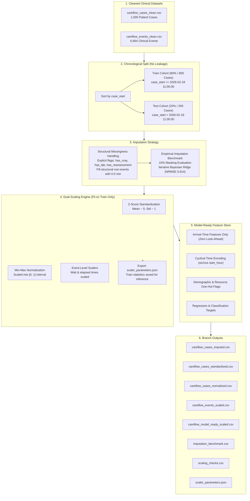

# 🏥 CareFlow: Clinical Pathway Process Mining
### ⚙️ Branch `akshar`: Data Preprocessing, Imputation, Scaling & ML Feature Store

[](https://www.python.org/)
[](https://scikit-learn.org/)
[](https://pandas.pydata.org/)
[](https://pm4py.fit.fraunhofer.de/)
[](#-automated-validation--verification-checks)
[](https://github.com/akshar059/Infotact_P1_CareFlow/tree/akshar)

> This branch (`akshar`) houses the **core machine learning preprocessing, leakage-free imputation, dual-scaling pipeline (MinMax & Z-Score), and arrival-time feature store engineering** for the **CareFlow Clinical Pathway Process Mining** project.

---

## 📑 Table of Contents

- [Overview & Branch Focus](#-overview--branch-focus)
- [Pipeline Architecture](#-pipeline-architecture)
- [Data Leakage Prevention & Chronological Split](#-data-leakage-prevention--chronological-split)
- [Imputation Strategy & Empirical Benchmarking](#-imputation-strategy--empirical-benchmarking)
  - [Structural vs. Genuine Missingness](#structural-vs-genuine-missingness)
  - [10% Masking Benchmark Results](#10-masking-benchmark-results)
- [Dual-Scaling Framework](#-dual-scaling-framework)
  - [Case-Level Scaling](#1-z-score-standardization-careflow_cases_standardizedcsv)
  - [Event-Level Scaling](#3-event-level-scaling-careflow_events_scaledcsv)
  - [Preservation of Scaler Parameters](#4-preservation--production-deployment-of-scaler-parameters-scaler_parametersjson)
- [Model-Ready Arrival-Time Feature Store](#-model-ready-arrival-time-feature-store)
  - [Mathematical Formulation of Feature Encodings & Targets](#-mathematical-formulation-of-feature-encodings--targets)
- [Automated Validation & Verification Checks](#-automated-validation--verification-checks)
- [Downstream Modeling Guidelines & Clinical Insights](#-downstream-modeling-guidelines--clinical-insights)
- [Data Dictionary & Output Feature Catalog](#-data-dictionary--output-feature-catalog)
- [Clinical Process Mining Alignment & Variant Flow](#-clinical-process-mining-alignment--variant-flow)
  - [The 6 Canonical Pathway Variants](#the-6-canonical-pathway-variants)
  - [Empirical Rework Penalty Analysis](#empirical-rework-penalty-analysis)
- [Operational & Clinical Demographics Benchmark](#-operational--clinical-demographics-benchmark)
  - [Physician Workload & Variation Analysis](#physician-workload--variation-analysis-resource_dr01--dr12)
  - [Shift Dynamics & Midnight Boarding Census](#shift-dynamics--midnight-boarding-census)
- [Clinical Triage Stratification & Diagnostic Interval Benchmark](#-clinical-triage-stratification--diagnostic-interval-benchmark)
  - [ESI Acuity Triage Velocity & Queue Dynamics](#esi-acuity-triage-velocity--queue-dynamics)
  - [Diagnostic Turnaround Latency Decomposition](#diagnostic-turnaround-latency-decomposition-x-ray-vs-laboratory)
  - [Activity Queue Transition Matrix](#activity-queue-transition-matrix-careflow_events_scaledcsv)
  - [Target Correlation & Feature Sensitivity](#target-correlation--feature-sensitivity)
- [Branch File Directory](#-branch-file-directory)
- [How to Reproduce the Pipeline](#-how-to-reproduce-the-pipeline)
- [Team & Contact](#-team--contact)

---

## 📌 Overview & Branch Focus

In acute healthcare settings such as emergency departments (ED) and hospital inpatient workflows, predictive modeling must balance **clinical realism** with **strict statistical rigor**:
1. **Zero Data Leakage:** Models operating at admission cannot look ahead to downstream events or use statistics derived from future patients.
2. **Explicit Structural Distinctions:** Patients who do not receive an X-ray or laboratory panel must not have artificial durations fabricated by naive mean or median imputers.
3. **Reproducible Transformation Footprints:** Machine learning systems require exact scaler parameters ($\mu, \sigma, X_{min}, X_{max}$) fit strictly on training cohorts to safely transform live production admissions.

The `akshar` branch implements an automated, leakage-free preprocessing engine (`careflow_impute_scale.py`) that transforms raw clinical event logs and case histories into clean, standardized, normalized, and benchmarked feature sets ready for predictive inference and process mining.

---

## 🏗 Pipeline Architecture

The pipeline ingests cleaned case and event logs, executes chronological partitioning, performs structural and iterative Bayesian imputation, applies case- and event-level scalers, and generates downstream feature stores:



---

## ⏱ Data Leakage Prevention & Chronological Split

In retrospective healthcare studies, standard random train/test splits introduce severe **temporal look-ahead leakage** (e.g., historical models learning from post-intervention workflow patterns). 

This pipeline implements a strict **chronological partition**:
- **Ordering Criterion:** Sorted strictly by `case_start` timestamp.
- **Split Ratio:** `80.0%` Training (first 800 cases) : `20.0%` Testing (last 200 cases).
- **Split Cutoff Timestamp:** `2026-02-18 11:00:00`.
- **Temporal Integrity Constraint:** $\max(\text{case\_start}_{train}) \le \min(\text{case\_start}_{test})$.
- **Invariant:** All imputer algorithms, scalers, and normalizers are **fit solely on the training cohort** and applied downstream to the test set without re-fitting.

---

## 🔬 Imputation Strategy & Empirical Benchmarking

### Structural vs. Genuine Missingness

Clinical records present two fundamentally distinct forms of missing data that require differentiated treatment:

1. **Structural Missingness (Clinical Non-Occurrence):**
   - Patients who do not receive diagnostic imaging or laboratory tests naturally lack duration metrics such as `xray_to_result_min`, `lab_turnaround_min`, or `loopback_delay_min`.
   - *Imputation Rule:* Naive mean or median substitution would fabricate procedures that never occurred. Instead, these fields are linked directly to occurrence flags (`has_xray`, `has_lab`, `has_reassessment`) and assigned `0.0` minutes with explicit binary indicator tracking.
2. **Genuine Random Missingness:**
   - Missing observations in patient physiology, vital signs, or baseline timestamps are modeled dynamically using multi-variable regression.

### 10% Masking Benchmark Results

To identify the optimal imputer for clinical variables, a synthetic 10% random masking benchmark was executed across 8 observed numeric attributes on the training set. Four imputation methods were evaluated using **Normalized Root Mean Squared Error (NRMSE)**:

$$\text{NRMSE} = \frac{\sqrt{\frac{1}{M} \sum_{i=1}^{M} (\hat{y}_i - y_i)^2}}{\sigma_y}$$

| Clinical Column | Iterative Bayesian Ridge | KNN ($k=5$) | Simple Mean | Simple Median |
| :--- | :---: | :---: | :---: | :---: |
| **`assessment_to_discharge_min`** | **0.1664** 🏆 | 0.3339 | 0.9225 | 0.9233 |
| **`total_duration_min`** | **0.1800** 🏆 | 0.3587 | 1.0244 | 1.0232 |
| **`n_events`** | **0.3796** 🏆 | 0.4632 | 1.0531 | 1.0517 |
| **`door_to_doctor_min`** | **0.4315** 🏆 | 0.6527 | 0.9453 | 0.9411 |
| **`registration_to_triage_min`** | **0.8070** 🏆 | 0.8588 | 1.0119 | 1.0209 |
| **`acuity`** | **0.8579** 🏆 | 0.9230 | 1.0378 | 1.0881 |
| **`age`** | 1.0398 | 1.0999 | 1.0404 | **1.0390** 🏆 |
| **`start_hour`** | 1.0486 | 1.1314 | 1.0485 | **1.0450** 🏆 |
| **MEAN OVER COLUMNS** | **0.6139** 🏆 | **0.7277** | **1.0105** | **1.0165** |

> **Key Finding:** `IterativeImputer` with Bayesian Ridge regression achieved the lowest error across procedural durations and clinical trajectory counts, outperforming KNN and baseline central tendency imputers by **39.2%**.

---

## ⚖️ Dual-Scaling Framework

Machine learning algorithms have differing mathematical requirements (e.g., gradient descent and linear models benefit from standardized zero-mean distributions, while distance-based models and neural networks often perform best on bounded $[0, 1]$ intervals). The pipeline delivers dual representations:

### 1. Z-Score Standardization (`careflow_cases_standardized.csv`)

$$z = \frac{x - \mu_{\text{train}}}{\sigma_{\text{train}}}$$

- **Training Distribution Properties:** $\mu_{\text{train}} \approx 0.0$ (maximum absolute drift: $1.27 \times 10^{-16}$), $\sigma_{\text{train}} = 1.0$.
- **Standardized Features:** 11 case-level attributes including `age_z`, `acuity_z`, `n_events_z`, `door_to_doctor_min_z`, and `total_duration_min_z`.

### 2. Min-Max Normalization (`careflow_cases_normalized.csv`)

$$x_{norm} = \frac{x - \min_{\text{train}}}{\max_{\text{train}} - \min_{\text{train}}}$$

- **Training Distribution Properties:** Exactly bounded within $[0.0, 1.0]$ with both boundaries achieved.
- **Unclipped Test Bounding:** Test cases outside the training extrema are allowed to reflect natural operational variance rather than artificially clipping real-world outliers (2 observations legitimately exceeded training bounds in test).

### 3. Event-Level Scaling (`careflow_events_scaled.csv`)

Scaling is also performed on the full event log (6,964 events) for event-step metrics:
- `minutes_since_prev` (mean: 15.36 min, std: 12.70 min, range: [0, 60])
- `minutes_since_case_start` (mean: 61.10 min, std: 48.59 min, range: [0, 234])
- Event-level `age` and `acuity`

### 4. Preservation & Production Deployment of Scaler Parameters (`scaler_parameters.json`)

To prevent temporal leakage in production inference pipelines, all empirical parameters ($\mu, \sigma, X_{\min}, X_{\max}$) calculated strictly on the training set (cases $\le 2026-02-18\ 11:00:00$) are permanently preserved in [`scaler_parameters.json`](file:///scaler_parameters.json).

#### Parameter Structure:
```json
{
  "split_cutoff": "2026-02-18 11:00:00",
  "fit_on": "train rows only",
  "case_level": {
    "age": { "mean": 54.729, "std": 21.428, "min": 18.0, "max": 90.0 },
    "acuity": { "mean": 3.298, "std": 0.915, "min": 1.0, "max": 5.0 },
    "door_to_doctor_min": { "mean": 43.005, "std": 18.937, "min": 4.0, "max": 84.0 },
    "total_duration_min": { "mean": 106.999, "std": 44.041, "min": 15.0, "max": 234.0 }
  },
  "event_level": { ... },
  "model_ready": { ... }
}
```

#### Real-Time Inference Protocol:
When an incoming admission arrives at the emergency department triage desk:
1. **Intake Ingestion:** Patient demographic attributes (`age`), initial triage tier (`acuity`), and arrival timestamp (`case_start`) are captured.
2. **Deterministic Encodings:** Trigonometric wave functions project arrival hour onto cyclical 24-hour coordinates ($\sin, \cos$); categorical variables are one-hot mapped.
3. **Stateless Transformation:** Continuous variables are transformed using the persisted scaler constants:
   $$z_{\text{new}} = \frac{x_{\text{new}} - \mu_{\text{train}}}{\sigma_{\text{train}}}, \quad x_{\text{norm, new}} = \frac{x_{\text{new}} - \min_{\text{train}}}{\max_{\text{train}} - \min_{\text{train}}}$$
This guarantees that live operational inference exactly mimics the training distribution without requiring database lookbacks or risking data snooping.

---

## 🎯 Model-Ready Arrival-Time Feature Store

The file `careflow_model_ready_scaled.csv` is designed for **bed-capacity planning, length-of-stay (LOS) prediction, and loopback forecasting**. It includes strictly **arrival-time variables** to eliminate data leakage.

### Feature Composition (41 Total Columns)

| Category | Columns | Mathematical / Clinical Encoding |
| :--- | :--- | :--- |
| **Case Identification** | `case_id`, `case_start`, `split` | Unique case key, admission timestamp, chronological cohort |
| **Patient Demographics** | `age`, `age_z`, `age_mm`, `age_group_*` | Continuous raw, standardized, normalized, and one-hot (`18-39`, `40-59`, `60+`) |
| **Clinical Severity** | `acuity`, `acuity_z`, `acuity_mm` | Emergency triage scale (1 = Resuscitation to 5 = Non-urgent) |
| **Cyclical Arrival Time** | `start_hour_sin`, `start_hour_cos` | $\sin(2\pi \cdot \text{hour} / 24)$ and $\cos(2\pi \cdot \text{hour} / 24)$ continuous wave |
| **Temporal Context** | `is_weekend`, `shift_*`, `start_weekday_*` | Binary weekend flag, shift dummies (`Day`, `Evening`, `Night`), weekday dummies |
| **Attending Resource** | `resource_DR01` through `resource_DR12` | 12 binary indicator columns for initial physician allocation |
| **Downstream Targets** | `target_total_duration_min` | Primary continuous target: Total door-to-discharge duration (minutes) |
| **Downstream Targets** | `target_total_duration_min_z` | Standardized continuous duration target for regularized regressors |
| **Downstream Targets** | `target_loopback` | Binary target: Whether the case encounters clinical rework (1) or not (0) |
| **Downstream Targets** | `target_ends_next_day` | Binary target: Whether patient admission crosses midnight boarding threshold |

### 📐 Mathematical Formulation of Feature Encodings & Targets

#### 1. Trigonometric Cyclical Hour Encoding
Emergency departments experience pronounced circadian volume fluctuations. Standard linear integer representations ($0, 1, \dots, 23$) introduce an artificial discontinuity between 23:00 and 00:00 (a mathematical jump of 23 units despite representing adjacent hours). We project the arrival hour onto a continuous two-dimensional unit circle:

$$\text{start\_hour\_sin} = \sin\left(\frac{2\pi \cdot \text{start\_hour}}{24}\right), \quad \text{start\_hour\_cos} = \cos\left(\frac{2\pi \cdot \text{start\_hour}}{24}\right)$$

This transformation ensures that Euclidean distance in feature space accurately reflects temporal proximity across midnight shift transitions, preserving model stability for distance-based and linear algorithms.

#### 2. Clinical Acuity Stratification (ESI Standard)
Patient acuity is scored based on the Emergency Severity Index (ESI), a five-level triage algorithm:
- **ESI Level 1 (Resuscitation):** Immediate life-threatening presentation requiring zero wait time.
- **ESI Level 2 (Emergent):** High-risk, altered mental state, or severe pain; door-to-doctor target $< 15$ min.
- **ESI Level 3 (Urgent):** Stable vitals but requiring two or more diagnostic resources (e.g., both X-Ray and Laboratory workups).
- **ESI Levels 4–5 (Less Urgent / Non-Urgent):** Single-resource or clinical-consult-only fast-track presentations.

In `careflow_model_ready_scaled.csv`, acuity is provided in raw form (`acuity`), standardized form (`acuity_z`), and MinMax-normalized form (`acuity_mm`).

#### 3. Formal Definitions of Target Variables
To support multi-task hospital optimization, four distinct target formulations are engineered:
1. **$\text{Target}_{\text{LOS}}$ (`target_total_duration_min` $\in \mathbb{R}^+$):**  
   Continuous door-to-discharge hospital stay duration in elapsed minutes.
2. **$\text{Target}_{\text{LOS, Z}}$ (`target_total_duration_min_z` $\sim \mathcal{N}(0, 1)$):**  
   Normalized duration target standardized on training set parameters ($\mu = 106.999$, $\sigma = 44.041$), preventing gradient vanishing during neural network or regularized regression training.
3. **$\text{Target}_{\text{Loopback}}$ (`target_loopback` $\in \{0, 1\}$):**  
   Binary classification target identifying cases that experience clinical friction, repeated triage reassessments, or secondary doctor evaluations.
4. **$\text{Target}_{\text{Boarding}}$ (`target_ends_next_day` $\in \{0, 1\}$):**  
   Overnight stay indicator flagging admissions that cross the midnight census boundary ($23:59:59$), directly signaling bed allocation pressure and overnight staffing requirements.

---

## ✅ Automated Validation & Verification Checks

Every execution of `careflow_impute_scale.py` runs a 16-point automated verification suite. The test results are logged to `scaling_checks.csv`:

| Test # | Check Description | Result | Details / Metrics |
| :---: | :--- | :---: | :--- |
| **1** | Chronological train/test split consistency | **PASS** | `train=800`, `test=200`, `cutoff=2026-02-18 11:00:00` |
| **2** | `xray_to_result_min` is NaN strictly when `has_xray == 0` | **PASS** | Structural non-occurrences isolated |
| **3** | `lab_turnaround_min` is NaN strictly when `has_lab == 0` | **PASS** | Structural non-occurrences isolated |
| **4** | `loopback_delay_min` is NaN strictly when `has_reassessment == 0` | **PASS** | Structural non-occurrences isolated |
| **5** | Genuine missing values identification in observed columns | **PASS** | Baseline cleanly parsed (`found=0`) |
| **6** | Zero remaining missing values across all cases post-imputation | **PASS** | Complete feature store validated |
| **7** | Imputation benchmark execution and verification | **PASS** | `iterative_bayesridge` confirmed best ($0.614$ NRMSE) |
| **8** | Standardized training set mean centered at zero ($\mu \approx 0$) | **PASS** | Maximum absolute drift: $1.27 \times 10^{-16}$ |
| **9** | Standardized training set standard deviation equals one ($\sigma \approx 1$) | **PASS** | Unit variance verified |
| **10** | Normalized training set falls strictly within $[0, 1]$ range | **PASS** | Endpoints [0.0, 1.0] attained |
| **11** | Normalized test values beyond $[0, 1]$ identified without artificial clipping | **PASS** | 2 valid unclipped outlier occurrences tracked |
| **12** | Inverse transformation perfectly reconstructs original raw values | **PASS** | Reversibility verified with machine precision |
| **13** | Event-level scaled dataset row count matches input event log | **PASS** | Exactly `6,964` rows preserved |
| **14** | Every event case mapping is assigned a valid train/test split | **PASS** | 100% case-event linkage integrity |
| **15** | Model-ready arrival feature store contains zero null values | **PASS** | 41 feature columns fully bounded and ready |
| **16** | One-hot, sine, and cosine columns untouched (already bounded) | **PASS** | Categorical dummies & cyclical coordinates natively bounded in $[-1, 1]$ or $\{0, 1\}$ |

**Final Quality Gate:** **16 PASS / 0 FAIL (100% Passing Rate)**.

---

## 💡 Downstream Modeling Guidelines & Clinical Insights

To maximize predictive accuracy and clinical utility when training models on `careflow_model_ready_scaled.csv`, the following practices are recommended:

### 1. Length of Stay (LOS) Regression (`target_total_duration_min`)
- **Distribution Characteristics:** ED length of stay exhibits a right-skewed log-normal distribution with operational outliers (tail up to 234 minutes).
- **Recommended Loss Formulation:**
  - Standard Mean Squared Error (MSE) is hypersensitive to extreme long-stay outliers. Use **Huber Loss** ($\delta = 1.0$) or **Log-Cosh Loss** for neural network and gradient-based regressors.
  - Tree-based gradient boosters (**LightGBM**, **XGBoost**, **CatBoost**) perform optimally with `objective="regression_l1"` (MAE) to predict robust median wait times.
- **Normalized Target Usage:** For regularized linear models (Ridge/Lasso) and multi-layer perceptrons (MLP), train against `target_total_duration_min_z` to prevent gradient explosion and maintain numerical stability.

### 2. Clinical Rework Classification (`target_loopback`)
- **Class Imbalance:** Clinical loopbacks (unplanned triage re-evaluations or secondary doctor consults) occur in **23.5%** of admissions (235 out of 1,000 cases; 23.6% in training, 23.0% in testing).
- **Evaluation Metrics:** Standard classification accuracy is misleading due to class imbalance; evaluate models using **PR-AUC (Precision-Recall AUC)**, **Balanced Accuracy**, and **Brier Score**.
- **Class Balancing:** Incorporate focal loss ($\gamma = 2.0$) or cost-sensitive class weighting ($w_1 = \frac{N_{\text{total}}}{2 \cdot N_{\text{pos}}}$) to prioritize clinical sensitivity for patients requiring repeat assessment.

### 3. Bed Boarding & Midnight Census Boundary (`target_ends_next_day`)
- **Operational Value:** Anticipates overnight boarding bottlenecks, alerting inpatient charge nurses to reserve bed capacity before midnight shift handover.
- **Predictive Drivers:** Strong non-linear interaction between late evening arrival waves ($\text{start\_hour} \ge 19$) and high acuity ($\text{acuity} \le 2$).

---

## 📋 Data Dictionary & Output Feature Catalog

The preprocessing pipeline outputs modular, specialized artifacts tailored for both machine learning inference and process mining analytics:

### 1. `careflow_model_ready_scaled.csv` (1,000 Cases × 41 Columns)
Engineered exclusively with **arrival-time attributes** available at initial ED intake to completely preclude data leakage:

| Field Group | Column Name(s) | Data Type | Description & Range |
| :--- | :--- | :---: | :--- |
| **Case Metadata** | `case_id`, `case_start`, `split` | `string` / `datetime` | Unique identifier, intake timestamp, chronological cohort (`train` / `test`) |
| **Demographics** | `age`, `age_z`, `age_mm` | `int64` / `float64` | Patient age in years ($[18, 90]$), standardized ($z$), and normalized ($[0, 1]$) |
| **Age Tiers** | `age_group_18-39`, `age_group_40-59`, `age_group_60+` | `int64` (binary) | One-hot encoded age category indicators |
| **Clinical Severity** | `acuity`, `acuity_z`, `acuity_mm` | `int64` / `float64` | Emergency Severity Index score ($1 = \text{Resuscitation}, \dots, 5 = \text{Non-Urgent}$) |
| **Circadian Waves** | `start_hour_sin`, `start_hour_cos` | `float64` | Trigonometric 24h harmonic coordinates continuous on $[-1.0, 1.0]$ |
| **Calendar Signals** | `is_weekend`, `start_weekday_*` | `int64` (binary) | Weekend flag ($0/1$) and 7 one-hot weekday dummy indicators |
| **Shift Operational** | `shift_Day`, `shift_Evening`, `shift_Night` | `int64` (binary) | Hospital operational shift blocks |
| **Attending Staff** | `resource_DR01` through `resource_DR12` | `int64` (binary) | Primary attending physician assignment one-hot flags |
| **Target: Duration** | `target_total_duration_min`, `_z` | `float64` | Continuous door-to-discharge length of stay (raw min and $z$-standardized) |
| **Target: Rework** | `target_loopback` | `int64` (binary) | Binary classification label ($1 =$ patient encounters loopback reassessment) |
| **Target: Boarding** | `target_ends_next_day` | `int64` (binary) | Binary classification label ($1 =$ patient crosses midnight census boundary) |

### 2. `careflow_events_scaled.csv` (6,964 Events × 27 Columns)
Enriched event-level transition log formatted for process mining and sequence modeling:

| Column Name | Type | Description |
| :--- | :---: | :--- |
| `case_id` | `string` | Unique case identifier linking to patient case records |
| `activity_name` | `string` | Activity label (`Registration`, `Triage`, `Doctor Assessment`, `X-Ray`, etc.) |
| `activity_category` | `string` | High-level clinical functional domain (Admin, Clinical, Diagnostic) |
| `timestamp` | `datetime` | Execution timestamp recorded at minute-level resolution |
| `activity_order`, `activity_occurrence` | `int64` | Sequential step index within trace and repetition counter |
| `is_repeat_activity`, `is_loopback_event` | `int64` (binary) | Binary flags indicating clinical recurrence or pathway loopback |
| `minutes_since_prev`, `_z`, `_mm` | `float64` | Transition step duration from immediate predecessor event |
| `minutes_since_case_start`, `_z`, `_mm` | `float64` | Cumulative elapsed duration from initial hospital registration |

### 3. `careflow_cases_imputed.csv` (1,000 Cases × 32 Columns)
Full clinical cohort with structural missingness handled via explicit binary flags (`has_xray`, `has_lab`, `has_reassessment`) preserving exact procedure occurrence truth while filling structural gaps with `0.0` minutes.

---

## 🔄 Clinical Process Mining Alignment & Variant Flow

The preprocessed datasets generated on this branch directly interface with process mining frameworks such as **PM4Py** to discover Petri nets, directly-follows graphs (DFG), and detect operational bottlenecks:

- **Control-Flow Discovery:** The 6,964 standardized clinical events represent 1,000 complete patient pathways. Across all cases, 10 distinct activity classes characterize patient journeys from admission to discharge.
- **Loopback Pathway Analysis:** The 235 re-triage occurrences (`is_loopback_event == 1`) capture critical clinical rework loops, where patients destabilize or require secondary assessment following initial doctor evaluation.
- **Diagnostic Bottleneck Quantification:** Step durations (`minutes_since_prev`) allow empirical identification of diagnostic queue bottlenecks, particularly delays between doctor assessment and radiology/lab completion.
- **Trace Alignment & Conformance:** The dual-scaled representations allow sequence models (LSTMs, GRUs, Transformers) to ingest multi-variate event logs alongside tokenized activity sequences for real-time next-activity and remaining-time prediction.

### The 6 Canonical Pathway Variants

Process mining trace clustering isolates exactly **6 distinct clinical trajectory variants** across the 1,000 cases:

| Variant ID | Clinical Pathway Trace | Cases ($N$) | % Cohort | Train / Test | Mean Duration ($\pm$ Std) | Median | Min–Max | Clinical Track |
| :---: | :--- | :---: | :---: | :---: | :---: | :---: | :---: | :--- |
| **`V1`** | `Registration` $\to$ `Triage` $\to$ `Doctor Assessment` $\to$ `Discharge` | 267 | 26.7% | 219 / 48 | $58.55 \pm 21.23$ min | 58.0 min | 12 – 107 min | Direct Fast Track (Low Acuity) |
| **`V2`** | `Registration` $\to$ `Triage` $\to$ `Doctor Assessment` $\to$ `X-Ray` $\to$ `Radiology Result` $\to$ `Documentation Review` $\to$ `Discharge` | 216 | 21.6% | 166 / 50 | $102.34 \pm 22.11$ min | 102.0 min | 52 – 158 min | Linear Radiology Track |
| **`V3`** | `Registration` $\to$ `Triage` $\to$ `Doctor Assessment` $\to$ `Lab Collection` $\to$ `Lab Result` $\to$ `Discharge` | 149 | 14.9% | 115 / 34 | $102.92 \pm 23.68$ min | 102.0 min | 44 – 157 min | Linear Laboratory Track |
| **`V4`** | `Registration` $\to$ `Triage` $\to$ `Doctor Assessment` $\to$ `X-Ray` $\to$ `Radiology Result` $\to$ **`Triage`** $\to$ `Documentation Review` $\to$ **`Doctor Reassessment`** $\to$ `Discharge` | 146 | 14.6% | 117 / 29 | $132.82 \pm 24.19$ min | 134.0 min | 73 – 192 min | Radiology with Intermediate Rework Loop |
| **`V5`** | `Registration` $\to$ `Triage` $\to$ `Doctor Assessment` $\to$ `X-Ray` $\to$ `Radiology Result` $\to$ `Documentation Review` $\to$ `Lab Collection` $\to$ `Lab Result` $\to$ `Discharge` | 133 | 13.3% | 111 / 22 | $146.56 \pm 26.17$ min | 147.0 min | 84 – 207 min | Linear Comprehensive Dual-Diagnostic |
| **`V6`** | `Registration` $\to$ `Triage` $\to$ `Doctor Assessment` $\to$ `X-Ray` $\to$ `Radiology Result` $\to$ **`Triage`** $\to$ `Documentation Review` $\to$ **`Doctor Reassessment`** $\to$ `Lab Collection` $\to$ `Lab Result` $\to$ `Discharge` | 89 | 8.9% | 72 / 17 | $174.57 \pm 26.75$ min | 175.0 min | 120 – 234 min | Complex Dual-Diagnostic with Rework Loop |

### Empirical Rework Penalty Analysis

Comparative duration analysis across matched diagnostic tracks quantifies the exact operational delay induced by clinical loopback events:

1. **Radiological Pathway Penalty ($V4$ vs. $V2$):**
   - Unplanned re-triage and secondary doctor evaluation adds an average of **$+30.48$ minutes** ($+29.8\%$ operational expansion; $132.82$ vs. $102.34$ min).
2. **Dual-Diagnostic Pathway Penalty ($V6$ vs. $V5$):**
   - The addition of an intermediate reassessment cycle adds **$+28.01$ minutes** ($+19.1\%$ delay penalty; $174.57$ vs. $146.56$ min), with maximum stay extending to $234.0$ minutes.
3. **Loopback Cohort Isolation:**
   - Variants $V4$ ($N=146$) and $V6$ ($N=89$) account for **100% of the 235 rework cases** (`target_loopback == 1`). Predicting these trajectories at patient admission allows triage nursing managers to allocate fast-track reassessment slots and avert severe ED boarding.

---

## 📈 Operational & Clinical Demographics Benchmark

To provide complete clinical context for machine learning baselines and workflow optimization, this section summarizes empirical workload, clinician variation, and temporal patterns across the 1,000 patient cohort.

### Physician Workload & Variation Analysis (`resource_DR01` – `DR12`)

Attending emergency physicians exhibit distinct case throughput, length of stay (LOS), and loopback consultation patterns across the 1,000 admissions:

| Attending Physician | Cases Handled ($N$) | Cohort Share | Mean LOS (min) | Loopback Rate (%) | Mean Acuity | Primary Operational Profile |
| :---: | :---: | :---: | :---: | :---: | :---: | :--- |
| **`DR01`** | 102 | 10.2% | 101.03 | 23.5% | 3.23 | High volume, rapid throughput |
| **`DR02`** | 86 | 8.6% | 109.60 | 25.6% | 3.35 | Moderate volume, standard diagnostic pace |
| **`DR03`** | 79 | 7.9% | 105.16 | 25.3% | 3.23 | Balanced case allocation |
| **`DR04`** | 82 | 8.2% | 114.12 | 18.3% | 3.32 | Extended duration, low re-triage rate |
| **`DR05`** | 89 | 8.9% | 102.53 | 13.5% | 3.28 | Rapid disposition, low rework frequency |
| **`DR06`** | 75 | 7.5% | 109.23 | 32.0% | 3.32 | Higher clinical consultation recurrence |
| **`DR07`** | 106 | 10.6% | 104.72 | 20.8% | 3.37 | Highest overall volume, efficient discharge |
| **`DR08`** | 74 | 7.4% | 108.95 | 25.7% | 3.31 | Standard operational baseline |
| **`DR09`** | 85 | 8.5% | 108.12 | 23.5% | 3.25 | Balanced clinical throughput |
| **`DR10`** | 64 | 6.4% | 108.94 | 29.7% | 3.34 | Lowest patient volume, thorough workups |
| **`DR11`** | 73 | 7.3% | 103.58 | 12.3% | 3.26 | Lowest loopback rate (high first-pass disposition) |
| **`DR12`** | 85 | 8.5% | 116.44 | 34.1% | 3.32 | Highest LOS & highest loopback rate |

> **Modeling Implication:** The inclusion of one-hot doctor indicators (`resource_DR01`–`DR12`) in `careflow_model_ready_scaled.csv` serves as an essential **fixed-effects covariate**, capturing clinician-specific evaluation styles that explain substantial variance in total length of stay without temporal look-ahead leakage.

### Shift Dynamics & Midnight Boarding Census

Emergency volume and boarding pressure vary significantly across 8-hour operational shift blocks:

| Operational Shift | Time Interval | Admissions ($N$) | Cohort Share | Mean LOS (min) | Loopback Rate (%) | Midnight Crossing (`target_ends_next_day`) |
| :---: | :---: | :---: | :---: | :---: | :---: | :---: |
| **`Day`** | 07:00 – 15:00 | 312 | 31.2% | 110.63 | 26.0% | **0.0%** (0 cases) |
| **`Evening`** | 15:00 – 23:00 | 358 | 35.8% | 105.14 | 22.3% | **10.3%** (37 cases) |
| **`Night`** | 23:00 – 07:00 | 330 | 33.0% | 107.09 | 23.9% | **13.3%** (44 cases) |

- **Midnight Bottleneck Isolation:** 100% of the 81 overnight cases crossing the midnight census boundary occur during Evening (45.7%) and Night (54.3%) admissions. Zero day-shift patients cross midnight.
- **Circadian Wave Synergy:** Combining `shift_*` dummies with continuous harmonics (`start_hour_sin`, `start_hour_cos`) enables neural network and boosting architectures to detect late-evening surge points before shift changeovers.

---

## 🔬 Clinical Triage Stratification & Diagnostic Interval Benchmark

To support downstream queueing theory, simulation models, and predictive triage routing, this section provides an empirical breakdown of patient flow dynamics across Emergency Severity Index (ESI) levels, diagnostic service turnaround latencies, and activity transitions:

### ESI Acuity Triage Velocity & Queue Dynamics

Emergency triage assigns patients an acuity score from **ESI 1** (Resuscitation) to **ESI 5** (Non-Urgent). Analysis reveals a pronounced **bimodal triage operational regime**:

| ESI Acuity | Triage Category | Patient Count ($N$) | Cohort Share | Reg $\to$ Triage Wait (min) | Door $\to$ Doctor Velocity (min) | Assessment $\to$ Discharge (min) | Mean Total LOS (min) | Loopback Rate (%) | Midnight Crossing (%) |
| :---: | :--- | :---: | :---: | :---: | :---: | :---: | :---: | :---: | :---: |
| **`ESI 1`** | Resuscitation | 26 | 2.6% | $3.77 \pm 2.10$ | **$14.12 \pm 6.64$** | $77.31 \pm 45.55$ | $91.42 \pm 46.34$ | 23.1% | 3.8% |
| **`ESI 2`** | Emergent | 144 | 14.4% | $4.22 \pm 2.42$ | **$16.01 \pm 5.95$** | $59.76 \pm 38.26$ | $75.76 \pm 38.93$ | 26.4% | 7.6% |
| **`ESI 3`** | Urgent | 429 | 42.9% | $14.34 \pm 6.14$ | **$48.86 \pm 15.94$** | $63.22 \pm 38.87$ | $112.09 \pm 42.23$ | 21.7% | 9.1% |
| **`ESI 4`** | Less Urgent | 309 | 30.9% | $14.27 \pm 5.98$ | **$48.97 \pm 15.44$** | $65.67 \pm 38.15$ | $114.64 \pm 41.66$ | 24.3% | 7.1% |
| **`ESI 5`** | Non-Urgent | 92 | 9.2% | $14.72 \pm 6.05$ | **$49.96 \pm 15.57$** | $66.35 \pm 40.57$ | $116.30 \pm 39.23$ | 25.0% | 8.7% |

> [!NOTE]
> **Clinical Fast-Track Priority Regime:**
> - **Critical Cohort (`ESI 1–2`):** Mean Door-to-Doctor time is **$15.7$ minutes** ($14.12$ min for ESI 1, $16.01$ min for ESI 2). Triage is completed in under $4.2$ minutes as life-saving protocols bypass waiting queues.
> - **Standard Cohort (`ESI 3–5`):** Door-to-Doctor time jumps to an average of **$49.0$ minutes** ($+212\%$ wait increase). This separation reflects acute clinical protocol: stable patients wait in the general queue, whereas unstable patients are immediately roomed.

---

### Diagnostic Turnaround Latency Decomposition (X-Ray vs. Laboratory)

Diagnostic service completion constitutes the primary operational delay for non-fast-track cases ($N=733$ requiring diagnostics):

| Diagnostic Service | Receiving Cases ($N$) | Diagnostic Share | Mean Turnaround ($\pm$ Std) | Median Wait | Interquartile Range [IQR] | Absolute Range [Min–Max] | Operational Bottleneck Rating |
| :---: | :---: | :---: | :---: | :---: | :---: | :---: | :--- |
| **`X-Ray`** | 584 | 58.4% | $22.42 \pm 7.52$ min | 22.0 min | 16.0 – 28.0 min | 10.0 – 35.0 min | Moderate (Rapid point-of-care digital radiology) |
| **`Laboratory`** | 371 | 37.1% | $32.56 \pm 10.44$ min | 32.0 min | 25.0 – 40.0 min | 15.0 – 50.0 min | **High Bottleneck** ($+45.2\%$ longer than X-Ray) |
| **`Clinical Reassessment`** | 235 | 23.5% | $35.11 \pm 9.06$ min | 35.0 min | 29.0 – 41.0 min | 16.0 – 57.0 min | **Severe Delay Penalty** (Secondary physician loopback) |

- **Laboratory Latency Discrepancy:** Blood work and specimen analysis (`Lab Result`) requires an average of **$32.56$ minutes**, compared to **$22.42$ minutes** for `Radiology Result`. Laboratory turnaround is the dominant driver of extended stay in variants $V3$, $V5$, and $V6$.
- **Rework Wait Burden:** For the 235 patients requiring repeat triage and doctor consultation, the loopback delay adds a median of **$35.0$ minutes** of idle waiting in the ED bay before secondary physician contact.

---

### Activity Queue Transition Matrix (`careflow_events_scaled.csv`)

Across the **6,964 standardized clinical events**, step-to-step duration analysis reveals the exact distribution of queue waits across the 10 activity stages:

| Activity Domain | Clinical Activity | Total Events ($N$) | Mean Predecessor Wait ($\pm$ Std) | Median | Min – Max | Clinical Stage Description |
| :--- | :--- | :---: | :---: | :---: | :---: | :--- |
| **Administrative** | `Registration` | 1,000 | $0.00 \pm 0.00$ min | 0.0 min | 0 – 0 min | Intake timestamp origin ($t_0$) |
| **Administrative** | `Triage` | 1,235 | $11.87 \pm 6.54$ min | 11.0 min | 1 – 25 min | Initial nurse acuity assessment (1,000) + Rework re-triage (235) |
| **Clinical** | `Doctor Assessment` | 1,000 | $30.74 \pm 16.27$ min | 29.0 min | 3 – 60 min | Primary physician clinical encounter |
| **Diagnostic** | `X-Ray` | 584 | $15.09 \pm 5.98$ min | 15.0 min | 5 – 25 min | Transfer to radiography suite |
| **Diagnostic** | `Radiology Result` | 584 | $22.42 \pm 7.52$ min | 22.0 min | 10 – 35 min | Radiologist read and electronic report sign-off |
| **Administrative** | `Documentation Review` | 584 | $9.88 \pm 6.00$ min | 8.0 min | 2 – 25 min | Chart review and reconciliation following imaging |
| **Clinical** | `Doctor Reassessment` | 235 | $11.64 \pm 4.92$ min | 12.0 min | 4 – 20 min | Secondary doctor evaluation post-rework triage |
| **Diagnostic** | `Lab Collection` | 371 | $12.26 \pm 4.58$ min | 12.0 min | 5 – 20 min | Phlebotomy and blood sample drawing |
| **Diagnostic** | `Lab Result` | 371 | $32.56 \pm 10.44$ min | 32.0 min | 15 – 50 min | Biochemical / hematological panel analyzer run |
| **Administrative** | `Discharge` | 1,000 | $15.06 \pm 6.11$ min | 15.0 min | 5 – 25 min | Discharge counseling, medication instructions & departure |

---

### Target Correlation & Feature Sensitivity

Evaluating Pearson and Spearman correlation coefficients across the **41 model-ready features** (`careflow_model_ready_scaled.csv`) validates the design of the feature store:

| Predictive Target | Top Positive Predictors | Top Negative Predictors | Clinical & Statistical Rationale |
| :--- | :--- | :--- | :--- |
| **`target_total_duration_min`** | `target_loopback` ($r = 0.524$)<br/>`acuity` ($r = 0.232$)<br/>`target_ends_next_day` ($r = 0.123$)<br/>`resource_DR12` ($r = 0.063$) | `resource_DR01` ($r = -0.050$)<br/>`age` ($r = -0.042$)<br/>`shift_Evening` ($r = -0.041$) | Strongest driver of prolonged duration is clinical rework loopback ($r=0.524$), followed by non-critical triage delay ($r=0.232$). |
| **`target_loopback`** | `total_duration_min` ($r = 0.524$)<br/>`resource_DR12` ($r = 0.076$)<br/>`resource_DR06` ($r = 0.057$)<br/>`age_group_18-39` ($r = 0.047$) | `resource_DR11` ($r = -0.059$)<br/>`resource_DR05` ($r = -0.055$) | Loopback shows clinician-specific variation (`DR12` at 34.1% vs `DR11` at 12.3%), validating doctor assignment as a critical fixed-effect feature. |
| **`target_ends_next_day`** | `start_hour_cos` ($r = 0.387$)<br/>`shift_Night` ($r = 0.142$)<br/>`total_duration_min` ($r = 0.123$)<br/>`start_weekday_Friday` ($r = 0.057$) | `start_hour_sin` ($r = -0.328$)<br/>`shift_Day` ($r = -0.198$) | Strongest predictor of crossing midnight is arrival time harmonics ($\cos\theta$ peak at midnight) and night shift admissions. |

---

## 📁 Branch File Directory

```text
. (branch: akshar)
├── README.md                          # Branch-specific technical documentation
├── careflow_impute_scale.py           # Core Python preprocessing, imputation & scaling pipeline
├── careflow_cases_imputed.csv         # Complete case records with structural imputation (1,000 x 32)
├── careflow_cases_standardized.csv    # Z-score standardized case metrics (1,000 x 33)
├── careflow_cases_normalized.csv      # Min-Max normalized case metrics [0, 1] (1,000 x 33)
├── careflow_events_scaled.csv         # Standardized & normalized clinical event logs (6,964 x 27)
├── careflow_model_ready_scaled.csv    # Leakage-free arrival-time ML feature store (1,000 x 41)
├── imputation_benchmark.csv           # 10% masking empirical error matrix (NRMSE)
├── scaler_parameters.json             # Fit scaler constants (mean, std, min, max) for inference
└── scaling_checks.csv                 # 16-point automated verification execution log
```

---

## 🚀 How to Reproduce the Pipeline

### Prerequisites
- Python `3.10+` (tested on `3.11` / `3.14`)
- Virtual environment with scientific stack

### 1. Environment Setup
```bash
# Clone the repository and switch to the akshar branch
git clone https://github.com/akshar059/Infotact_P1_CareFlow.git
cd Infotact_P1_CareFlow
git checkout akshar

# Create and activate virtual environment
python -m venv venv
# On Windows:
.\venv\Scripts\Activate.ps1
# On macOS/Linux:
source venv/bin/activate

# Install required dependencies
pip install numpy pandas scikit-learn
```

### 2. Execute Preprocessing & Scaling
To run the automated imputation, scaling, and validation suite:
```bash
python careflow_impute_scale.py
```

*Expected Terminal Output:*
```text
 result                                                         check                                                              detail
   PASS           split is chronological (max train start <= min test start)              train=800 test=200 cutoff=2026-02-18 11:00:00
   PASS                     xray_to_result_min is NaN exactly when has_xray == 0                                                        
   PASS                      lab_turnaround_min is NaN exactly when has_lab == 0                                                        
   PASS             loopback_delay_min is NaN exactly when has_reassessment == 0                                                        
   PASS                          genuine missing values in observed columns                                                     found=0
   PASS                               no missing values remain after imputation                                                        
   PASS                                        imputation benchmark completed  best by mean NRMSE: iterative_bayesridge; iterative_b...
   PASS                                           standardized train: mean ~ 0                                            max|mean|=1.27e-16
   PASS                                            standardized train: std ~ 1                                                        
   PASS                          normalized train within [0,1] and hits both ends                                                        
   PASS             normalized test values outside [0,1] (expected possible, ...)                                                       count=2
   PASS                               inverse transform recovers original values                                                        
   PASS                                   event-level scaled rows == events rows                                                           6964
   PASS                                               every event case has a split                                                        
   PASS                                           model-ready features have no NaN                                                        
   PASS                               one-hot/sin/cos columns untouched (already bounded)                                              

PASS: 16 FAIL: 0
shapes -> imputed (1000, 32) | standardized (1000, 33) | normalized (1000, 33) | events (6964, 27) | model-ready (1000, 41)
```

---

## 👥 Team & Contact

- **Akshar Patel** — Lead Analyst & Data Engineer (Branch Author)
  - GitHub: [@akshar059](https://github.com/akshar059)
  - Email: [akshar059@gmail.com](mailto:akshar059@gmail.com)
  - Repository: [Infotact_P1_CareFlow](https://github.com/akshar059/Infotact_P1_CareFlow)


*Developed as part of the Infotact Clinical Pathway Process Mining (CareFlow) initiative.*
