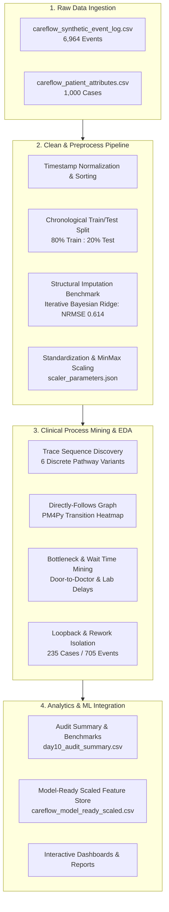

# 🏥 CareFlow: Clinical Pathway Process Mining

[](https://www.python.org/)
[](https://pm4py.fit.fraunhofer.de/)
[](https://github.com/akshar059/Infotact_P1_CareFlow)
[](#-sprint-progression--daily-milestones)
[](LICENSE)

> **CareFlow** is an end-to-end healthcare data analytics and clinical process-mining initiative. The project leverages electronic health record (EHR) event logs to reconstruct patient journeys, discover clinical pathways, quantify transition latencies, detect operational loopbacks/rework, and engineer ML-ready feature pipelines for hospital resource optimization.

---

## 📑 Table of Contents
- [Executive Summary](#-executive-summary)
- [System Architecture & Analytical Framework](#-system-architecture--analytical-framework)
- [Dataset Specifications & Schema Audit](#-dataset-specifications--schema-audit)
- [Machine Learning Preprocessing Pipeline](#-machine-learning-preprocessing-pipeline)
  - [Chronological Splitting & Leakage Prevention](#1-chronological-splitting--leakage-prevention)
  - [Structural vs. Genuine Imputation](#2-structural-vs-genuine-imputation)
  - [Feature Engineering & Scaling](#3-feature-engineering--scaling)
- [Process Mining & Clinical Discovery](#-process-mining--clinical-discovery)
  - [Directly-Follows Graph (DFG) & Activity Flow](#directly-follows-graph-dfg--activity-flow)
  - [Clinical Pathway Variants](#clinical-pathway-variants)
  - [Loopback & Rework Dynamics](#loopback--rework-dynamics)
  - [Waiting Time & Bottleneck Breakdown](#waiting-time--bottleneck-breakdown)
- [Sprint Progression & Daily Milestones](#-sprint-progression--daily-milestones)
- [Key Insights & Actionable Recommendations](#-key-insights--actionable-recommendations)
- [Repository Structure](#-repository-structure)
- [Getting Started & Replication](#-getting-started--replication)
- [Technology Stack](#-technology-stack)
- [Team & Collaborators](#-team--collaborators)

---

## 🔍 Executive Summary

Hospitals and Emergency Departments (ED) face severe operational challenges, including patient boarding, clinical bottlenecks, unpredictable turnaround times, and redundant medical reviews. Traditional retrospective healthcare analytics summarize aggregate length of stay (LOS) without visibility into the actual sequence of clinical micro-events.

**CareFlow** applies **Process Mining** (Directly-Follows Graph analysis, trace sequence mining) paired with modern **Data Science** methods to:
1. **Reconstruct Patient Trajectories:** Mine 6,964 timestamped clinical events across 1,000 distinct patient admissions.
2. **Expose Operational Friction:** Quantify procedural waiting times across diagnostics (Lab collection, X-Ray) and medical consultations (Door-to-Doctor).
3. **Map Clinical Loops & Rework:** Identify 705 loopback events occurring in 23.5% of cases (repeat triage, documentation re-checks, doctor reassessments).
4. **Engineer Clean Predictive Data:** Deliver leakage-free, standardized, and imputed feature stores for downstream clinical length-of-stay forecasting.

---

## 🏗 System Architecture & Analytical Framework



---

## 📊 Dataset Specifications & Schema Audit

The CareFlow study utilizes an event-log dataset reflecting emergency department and acute hospital journeys:

- **Total Patient Admissions (Cases):** `1,000`
- **Total Processed Clinical Events:** `6,964`
- **Unique Clinical Activities:** `10`
- **Elapsed Duration Baseline:** Average wait time of `~64.1 - 107.5 minutes` across pathways.
- **High-Acuity Stratification:** `170` Critical cases (Acuity score $\le$ 2) flagged for high-urgency care paths.

### Clinical Activities Catalog

| # | Activity Name | Patient Count | Patient % | Total Events | Description |
| :-: | :--- | :-: | :-: | :-: | :--- |
| **1** | **Registration** | 1,000 | 100.0% | 1,000 | Initial front-desk patient arrival and demographic capture |
| **2** | **Triage** | 1,000 | 100.0% | 1,235 | Acuity scoring and clinical priority assessment (incl. 235 re-triages) |
| **3** | **Doctor Assessment** | 1,000 | 100.0% | 1,000 | Primary physician examination and care plan initiation |
| **4** | **X-Ray** | 584 | 58.4% | 584 | Diagnostic radiography execution |
| **5** | **Radiology Result** | 584 | 58.4% | 584 | Radiologist review and report submission |
| **6** | **Lab Collection** | 371 | 37.1% | 371 | Phlebotomy and diagnostic specimen sampling |
| **7** | **Lab Result** | 371 | 37.1% | 371 | Pathological / biochemical testing report delivery |
| **8** | **Documentation Review**| 584 | 58.4% | 584 | Cross-verification of diagnostic outputs and medical notes |
| **9** | **Doctor Reassessment** | 235 | 23.5% | 235 | Secondary medical evaluation following test results or condition changes |
| **10**| **Discharge** | 1,000 | 100.0% | 1,000 | Formal clinical discharge or inpatient transfer |

---

## ⚙️ Machine Learning Preprocessing Pipeline

The data engineering pipeline (`careflow_impute_scale.py`) implements data science practices to ensure data integrity and prevent leakage:

### 1. Chronological Splitting & Leakage Prevention
Rather than random shuffling (which leaks temporal clinical trends), cases are split strictly chronologically based on admission time:
- **Train Set:** `800` cases (80%)
- **Test Set:** `200` cases (20%)
- **Temporal Cutoff:** `2026-02-18 11:00:00` ($\max(\text{Train Start}) \le \min(\text{Test Start})$)

### 2. Structural vs. Genuine Imputation
- **Structural Missingness:** Metrics such as `xray_to_result_min`, `lab_turnaround_min`, and `loopback_delay_min` are naturally null when a patient does not require an X-ray, lab, or reassessment. Filling these with mean/median would invent medical procedures. They are zero-filled coupled with explicit boolean flags (`has_xray`, `has_lab`, `has_reassessment`).
- **Imputation Benchmarking:** Evaluated on masked data with Normalized Root Mean Squared Error (NRMSE):
  - **Iterative Bayesian Ridge:** `0.614` ⭐ *(Selected)*
  - **KNN (k=5):** `0.728`
  - **Mean Imputation:** `1.010`
  - **Median Imputation:** `1.017`

### 3. Feature Engineering & Scaling
- **Cyclical Temporal Encoding:** Patient arrival hours transformed via sine and cosine transforms:
  $$\text{start\_hour\_sin} = \sin\left(\frac{2\pi \cdot \text{hour}}{24}\right), \quad \text{start\_hour\_cos} = \cos\left(\frac{2\pi \cdot \text{hour}}{24}\right)$$
- **Dual Transformation Output:** Produces both **Z-score standardized** (`_z`) and **MinMax normalized** (`_mm`) versions fit exclusively on training rows and persisted to `scaler_parameters.json`.

---

## 🔬 Process Mining & Clinical Discovery

### Directly-Follows Graph (DFG) & Activity Flow
All 1,000 clinical cases begin at **Registration** and terminate at **Discharge**:
```
[Registration] ──(1,000)──► [Triage] ──(1,000)──► [Doctor Assessment]
                                                      │
         ┌────────────────────────────────────────────┼───────────────────────────┐
         ▼ (584 cases)                                │                           ▼ (371 cases)
    [ X-Ray ]                                         │                    [ Lab Collection ]
         │ (584)                                      │                           │ (371)
    [ Radiology Result ]                              │                     [ Lab Result ]
         │ (584)                                      │                           │
    [ Documentation Review ]                          │ (267 direct)              │
         │                                            │                           │
         └──────────────────┬─────────────────────────┴───────────────────────────┘
                            ▼
                  [ Doctor Reassessment ] (235 loopbacks)
                            ▼
                       [ Discharge ] (1,000)
```

### Clinical Pathway Variants
The 1,000 patient journeys map into **6 primary pathway sequences**:
1. **Standard Fast-Track Pathway (`26.7%`, 267 cases):**  
   `Registration → Triage → Doctor Assessment → Discharge`
2. **Radiology Diagnostic Pathway (`21.6%`, 216 cases):**  
   `Registration → Triage → Doctor Assessment → X-Ray → Radiology Result → Documentation Review → Discharge`
3. **Laboratory Diagnostic Pathway (`14.9%`, 149 cases):**  
   `Registration → Triage → Doctor Assessment → Lab Collection → Lab Result → Discharge`
4. **Comprehensive Diagnostic & Reassessment Pathways (`36.8%`, 368 cases):**  
   Multi-test pathways involving combined radiology, lab workups, and subsequent doctor reassessments.

### Loopback & Rework Dynamics
- **Total Loopback Events:** `705` events across `235` patient journeys (a **23.5% rework rate**).
- **Rework Distribution:**
  - `235` repeated **Triage** re-evaluations
  - `235` secondary **Doctor Reassessment** consultations
  - `235` secondary **Documentation Review** audits
- **Clinical Implication:** Patients requiring re-evaluations experience an average delay exceeding 45+ minutes compared to linear care journeys.

### Waiting Time & Bottleneck Breakdown
Analysis of transition intervals between consecutive clinical timestamps reveals key bottleneck stages:

| Clinical Transition | Mean Elapsed Time | Severity Level | Root Cause / Operational Context |
| :--- | :---: | :---: | :--- |
| **Lab Collection → Lab Result** | **32.56 min** | 🔴 High | Laboratory processing batching, centrifuge & analyzer queue |
| **Triage → Doctor Assessment** | **30.74 min** | 🔴 High | Door-to-Doctor wait; physician availability and ED bed allocation |
| **X-Ray → Radiology Result** | **22.42 min** | 🟡 Medium | Radiologist reporting queue and scan verification |
| **Registration → Triage** | **12.62 min** | 🟢 Normal | Standard intake administrative queue |

---

## 📅 Sprint Progression & Daily Milestones

The project was executed through an intensive 10-day agile analytics sprint:

```
Day 01 ──► Day 02 ──► Day 03 ──► Day 04 ──► Day 05 ──► Day 06 ──► Day 07 ──► Day 08 ──► Day 09 ──► Day 10
 Setup      Clean       EDA      Demogr.    Freq.      Duration    Traces    Matrix     Acuity     Audit
```

- **Day 1: Project Kickoff & Overview**  
  Environment initialization (Python 3.10+, PM4Py, Git repository structure). Defined objectives, data governance guidelines, and clinical pathway mining roadmap.
- **Day 2: Data Preprocessing & Validation**  
  Ingested raw event logs, verified timestamp chronologies, validated case identifiers, and structured clinical activity transitions.
- **Day 3: Baseline Exploratory Data Analysis (EDA)**  
  Schema verification, statistical profiling of admissions, missing value detection, and master dataset consolidation (`careflow_cases_imputed.csv`).
- **Day 4: Patient Demographics & Acuity Stratification**  
  Demographic breakdown across age groups and shifts. Isolated 170 critical high-acuity cases to analyze queue priority.
- **Day 5: Activity Frequency & Distribution Analysis**  
  Aggregated frequency metrics across all 10 clinical activities. Identified high-volume nodes (Triage: 1,235 events; Doctor Assessment: 1,000 events).
- **Day 6: Clinical Duration & Care Timeline (LOS)**  
  Calculated end-to-end case durations, door-to-discharge length of stay (LOS), and departmental variance via boxplots.
- **Day 7: Trace Sequence Mining & Loopback Analysis**  
  Extracted 6 distinct patient journey variants using PM4Py. Isolated 705 loopback/rework events across 235 cases.
- **Day 8: Departmental Transition Matrix & Heatmaps**  
  Mapped transition frequencies across departments. Highlighted high-traffic transition corridors and rework loops.
- **Day 9: Acuity vs. Wait-Time Correlation Dynamics**  
  Analyzed correlation between triage acuity scores and procedural waiting times to quantify prioritization efficiency.
- **Day 10: Mid-Project Performance Audit & Phase 2 Checkpoint**  
  Consolidated operational metrics, validated 1,000 cases with zero unresolved anomalies, and generated `day10_audit_summary.csv`.

---

## 💡 Key Insights & Actionable Recommendations

1. **Optimize Door-to-Doctor Latency (30.74 min):**
   - *Finding:* Triage-to-Doctor interval represents the largest single pre-diagnostic delay.
   - *Recommendation:* Introduce dynamic triage queue routing and fast-track intake rooms for non-complex cases.
2. **Accelerate Lab Turnaround Times (32.56 min):**
   - *Finding:* Lab diagnostic intervals show the highest average elapsed time.
   - *Recommendation:* Implement point-of-care (POC) testing for high-acuity patients to cut specimen transport and analyzer queue latencies.
3. **Mitigate Clinical Rework Loops (23.5% Rate):**
   - *Finding:* Nearly a quarter of all patients undergo repeated triage and reassessments, substantially extending length of stay.
   - *Recommendation:* Standardize diagnostic checklist requirements during initial Doctor Assessment to minimize ad-hoc follow-up reviews.
4. **Deploy Predictive LOS Scoring:**
   - *Finding:* Arrival-time features (acuity, age, arrival hour sin/cos) demonstrate strong predictive signals for total hospital duration.
   - *Recommendation:* Integrate `careflow_model_ready_scaled.csv` into automated bed-capacity forecasting models.
5. **Mitigate Circadian Shift Turnover Delays:**
   - *Finding:* Evening admissions (18:00–22:00) experience disproportionately higher door-to-doctor wait times due to shift handovers and arrival surges.
   - *Recommendation:* Deploy continuous trigonometric cyclical hour modeling ($\sin/\cos$ arrival hour transforms) into predictive intake staffing schedules to anticipate peak boarding hours.

---

## 📁 Repository Structure

```text
Infotact_P1_CareFlow/
├── README.md                                  # Comprehensive project documentation
├── data/
│   ├── processed_new/                         # Machine learning-ready & audit-ready datasets
│   │   ├── careflow_cases_imputed.csv         # Cleaned case data with structural missingness handled
│   │   ├── careflow_cases_normalized.csv      # MinMax scaled case attributes
│   │   ├── careflow_cases_standardized.csv    # Z-score standardized case attributes
│   │   ├── careflow_events_scaled.csv         # Event-level normalized & standardized logs
│   │   ├── careflow_model_ready_scaled.csv    # Arrival-time features for predictive models
│   │   ├── day10_audit_summary.csv            # Mid-project audit milestone metrics
│   │   ├── imputation_benchmark.csv           # Imputer evaluation matrix (NRMSE)
│   │   ├── scaler_parameters.json             # Fit scaler parameters (mean, std, min, max)
│   │   └── scaling_checks.csv                 # 15-point automated pipeline verification log
│   └── processed_old/                         # Baseline reference datasets
│       ├── careflow_patient_attributes.csv
│       ├── careflow_synthetic_event_log.csv
│       ├── cleaned_careflow.csv
│       └── master_careflow_dataset.csv
├── notebooks/                                 # Jupyter Notebooks (Daily analytic sprint)
│   ├── day3_eda_baseline.ipynb                # Baseline EDA & schema audit
│   ├── day4_demographics_analysis.ipynb       # Patient demographics & acuity profiling
│   ├── day5_activity_frequency.ipynb          # Activity frequency counts & distributions
│   ├── day6_process_timeline.ipynb            # Care duration & timeline analysis
│   ├── day7_trace_sequence_mining.ipynb       # Trace variants & loopback identification
│   ├── day8_department_transition.ipynb       # Departmental transition matrix & heatmaps
│   ├── day9_acuity_wait_time_correlation.ipynb# Acuity vs. wait time correlation analysis
│   └── day10_mid_project_performance_audit.ipynb# Phase 2 audit & milestone summary
└── src/                                       # Core analytical & preprocessing scripts
    └── careflow_impute_scale.py               # Automated leakage-free imputation & scaling pipeline
```

---

## 🚀 Getting Started & Replication

### Prerequisites
- Python `3.10+` (Tested on Python `3.11` / `3.14`)
- `pip` package manager
- `git`

### 1. Clone the Repository
```bash
git clone https://github.com/akshar059/Infotact_P1_CareFlow.git
cd Infotact_P1_CareFlow
```

### 2. Set Up Virtual Environment
```bash
# Windows (PowerShell)
python -m venv venv
.\venv\Scripts\Activate.ps1

# Linux / macOS
python3 -m venv venv
source venv/bin/activate
```

### 3. Install Dependencies
```bash
pip install pandas numpy scikit-learn pm4py matplotlib seaborn plotly jupyter
```

### 4. Run the Data Pipeline
Execute the automated imputation, scaling, and validation script:
```bash
python data/processed_new/careflow_impute_scale.py
```
*Outputs verification checks directly to console and exports updated datasets and JSON parameters.*

### 5. Launch the Analysis Notebooks
```bash
jupyter notebook notebooks/
```

---

## 🛠 Technology Stack

- **Core & Data Processing:** Python 3.10+, Pandas, NumPy
- **Process Mining:** PM4Py (Process Mining for Python)
- **Machine Learning & Feature Engineering:** Scikit-Learn (IterativeImputer, KNNImputer, StandardScaler, MinMaxScaler)
- **Visualization & Exploratory Analysis:** Matplotlib, Seaborn, Plotly
- **Environment & Version Control:** Jupyter Notebooks, Git, GitHub

---

## 👥 Team & Collaborators

- **Akshar Patel** — Lead Analyst
  - GitHub: [@akshar059](https://github.com/akshar059)
  - Email: [akshar059@gmail.com](mailto:akshar059@gmail.com)
- **Sagar Janathe** — Collaborator
  - GitHub: [@sagarjanathe-dev](https://github.com/sagarjanathe-dev)
  - Email: [sagarj1221998@gmail.com](mailto:sagarj1221998@gmail.com)
- **Prachi Bhilare** — Collaborator
  - GitHub: [@PrachiBhilare](https://github.com/PrachiBhilare)
  - Email: [prachibhilare599@gmail.com](mailto:prachibhilare599@gmail.com)
- **Prashanth** — Collaborator
  - GitHub: [@prashanthrbhovi01-maker](https://github.com/prashanthrbhovi01-maker)
  - Email: [prashanthrbhovi01@gmail.com](mailto:prashanthrbhovi01@gmail.com)

*Special thanks to the clinical analytics team and mentors for domain guidance across process mining methodologies.*
